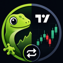

  

# GeckoTV Switcher

A minimal Chrome extension that automatically opens the TradingView chart on CoinGecko coin pages, instead of requiring a manual click on the "TradingView" toggle.

## What it does

On `https://www.coingecko.com/en/coins/*` pages it:

- switches the price chart to the **TradingView** view as soon as the toggle appears
- defaults the chart to the **1D** interval
- adds four moving averages: **SMA 200**, **SMA 50**, **EMA 8**, **EMA 34**
- colors them: EMA 8 green, EMA 34 yellow, SMA 50 orange (SMA 200 keeps the theme default)

## Install (unpacked)

1. Clone or download this repository.
2. Open `chrome://extensions`.
3. Enable **Developer mode** (top right).
4. Click **Load unpacked** and select the repository directory.
5. Visit a CoinGecko coin page in a fresh tab, e.g. `https://www.coingecko.com/en/coins/bitcoin`.
6. Confirm the TradingView chart loads automatically and defaults to the **1D** interval.

Requires a Chromium-based browser with Manifest V3 and `world: "MAIN"` content script support (Chrome 111+).

## How it works

No build step, no dependencies — three plain content scripts:

| File | Runs on | Purpose |
| --- | --- | --- |
| `content.js` | CoinGecko coin pages | Clicks `#live-chart-tradingview`, waiting up to 15s for it via `MutationObserver`. |
| `interval.js` | CoinGecko coin pages (main world, `document_start`) | Wraps the `HTMLIFrameElement.prototype.src` setter and rewrites the TradingView `widgetembed` config in the URL hash (interval + studies) before the iframe loads. |
| `indicator-colors.js` | `s.tradingview.com/widgetembed/*` iframe (main world) | Re-applies indicator colors every second, since TradingView resets study styles shortly after creation. |

## Customizing

- **Interval / indicators:** edit `config.interval` and `config.studies` in `interval.js`.
- **Colors:** edit `RULES` in `indicator-colors.js` (keyed by indicator length).

Reload the extension in `chrome://extensions` after changes.

## Privacy

The extension requests no permissions beyond its content script host matches, makes no network requests, and collects or stores no data.

## Limitations

It depends on CoinGecko's DOM (`#live-chart-tradingview`) and on undocumented TradingView widget internals (`window.chartWidget`), so it can break when either site changes. Only `/en/` coin pages are matched. If it stops working, please [open an issue](../../issues).

## Disclaimer

This is an independent project and is not affiliated with, endorsed by, or sponsored by CoinGecko or TradingView. All trademarks belong to their respective owners. Nothing here is financial advice.

## License

[MIT](LICENSE)
